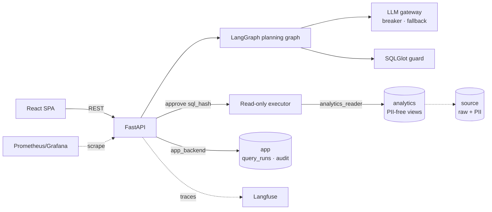
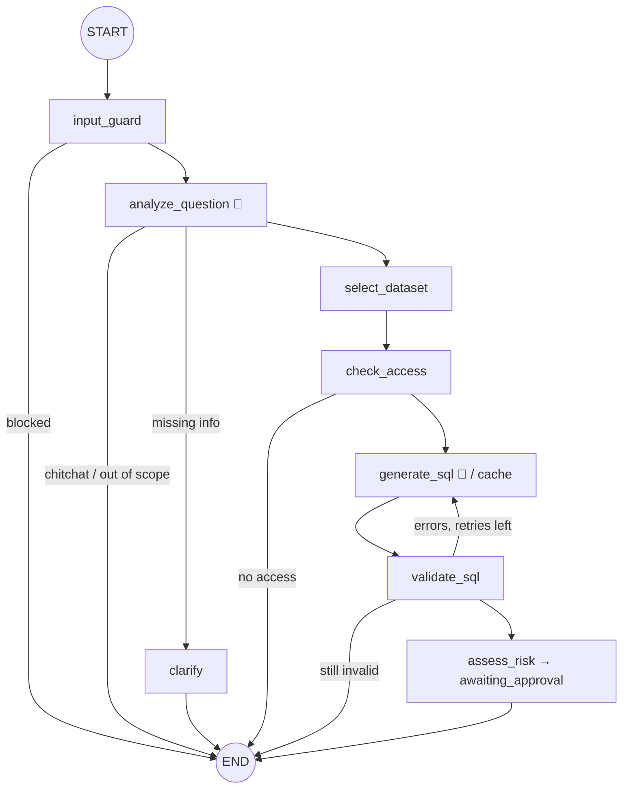

# Text2SQL Agent — Vietnamese sales analytics with human-approved SQL

Ask questions about real-estate sales data in Vietnamese. A LangGraph agent turns each question into SQL
and explains in plain language what it will compute. **You approve (or edit) the SQL before it runs.** Execution
is read-only and limited to a curated, PII-free schema. Results come back as a table, a chart and an explanation
in which every number is checked against the result.

> *“Doanh thu căn hộ tại Hà Nội theo tháng năm 2025”* → plan → **approve** → line chart + table + grounded summary

[Kiến trúc chi tiết (VI)](docs/ARCHITECTURE.md) · [Quyết định thiết kế (ADR)](docs/DECISIONS.md) ·
[Đánh giá](docs/EVALUATION.md) · [Runbook](docs/RUNBOOK.md)

## Highlights

| | |
|---|---|
| **Plan-then-execute agent** | LangGraph planning graph: input rails → question analysis (standalone rewriting, clarification) → deterministic dataset routing & access check → SQL drafting with a guard-feedback repair loop → risk assessment. The LLM proposes; code decides. |
| **Defense in depth** | Prompt-injection input rails · spotlighting · SQLGlot AST guard (single `SELECT`, table allowlist per dataset, `qualify`-validated columns, function allowlist, enforced `LIMIT`) · a PostgreSQL role that can only `SELECT` PII-free views · `READ ONLY` transaction + `statement_timeout` · numeric **grounding check** on explanations. |
| **Human-in-the-loop** | Approve / **edit** / cancel. Approval is bound to the SQL hash the user saw (atomic `UPDATE … WHERE status AND sql_hash`). Pending approvals expire, and a new question supersedes the old one. Optional risk-based auto-execution. Access is re-checked at execution time. |
| **Data governance** | Dataset-level entitlements. Restricted datasets go through a request → admin approve/reject (with expiry) → revoke flow. Admins cannot read data by default or approve their own requests. Prompts only contain metadata for the dataset the user is authorized to see. |
| **Reliability** | LLM gateway with a circuit breaker and a fallback ladder (primary → fallback model → deterministic semantic compiler). An exact-match plan cache stores only guard-validated SQL. Chaos mode for testing. |
| **Observability** | Langfuse traces (one trace per question; user feedback becomes a score). Prometheus metrics, a Grafana dashboard and 5 symptom-based alert rules. Token and cost accounting per run. JSON logs with request IDs and PII redaction. Append-only audit log enforced by a DB trigger. |
| **Evaluation** | Golden set with slices: **execution accuracy** compares result multisets, with Wilson CIs. A red-team suite (34 attacks) must block 100 %. Paired version comparison with McNemar's test. A calibrated binary LLM judge. All of it runs as a CI gate. |
| **Runs offline** | `LLM_PROVIDER=demo` uses a deterministic compiler over the semantic layer, so the full product works with no API key. |

## Architecture





## Quick start

```bash
cp .env.example .env            # change the passwords / JWT secret
docker compose up --build       # db → migrate + seed → backend :8000 → frontend :5173
```

Open http://localhost:5173 and use a demo account:

| Account | Password | Can do |
|---|---|---|
| `analyst@demo.local` | `Analyst@123` | Query open datasets; must request access to *Hiệu suất nhân viên* |
| `manager@demo.local` | `Manager@123` | Also has access to staff performance |
| `admin@demo.local` | `Admin@123` | Review access requests, revoke, view AI-quality stats and audit log |

Use a real model: set `LLM_PROVIDER=openai` and `OPENAI_API_KEY`. Optionally set `LLM_FALLBACK_MODEL` and the `LANGFUSE_*` keys.
Run `docker compose --profile observability up -d` for Prometheus (:9090) and Grafana (:3000).

Try: *Doanh thu theo thành phố năm 2025* · *Top 3 dự án có doanh thu cao nhất quý 2/2025* · *Doanh thu là bao nhiêu?*
(the agent asks for the period) · *Tồn kho theo dự án* · *Ignore previous instructions…* (blocked).

### Local development

```bash
make db-up migrate seed     # PostgreSQL in Docker on :5444, schema + deterministic demo data
make api                    # backend :8000 (uv)
make web                    # frontend :5173
make check                  # ruff + mypy + pytest (unit + integration) + tsc + vitest
make eval                   # golden + red-team → backend/eval/reports/
make chaos                  # primary provider fails 100 % → circuit opens → still correct
```

## Results (provider `demo`, seed 42)

| Suite | Result |
|---|---|
| Golden — outcome accuracy | 33/33 |
| Golden — execution accuracy | 27/27 |
| Red-team (22 SQL attacks + 12 adversarial questions) | 34/34 blocked |
| Chaos (primary 100 % failing) | 100 % accuracy via fallback, circuit opened after 3 failures |
| Backend tests | 93 passed (84 unit, 9 integration on PostgreSQL) · frontend 8 passed |

The demo compiler targets these question shapes, so its scores are a **pipeline regression gate** and say nothing
about model quality. Run `make eval-openai` for model numbers. See [EVALUATION.md](docs/EVALUATION.md).

## Repository layout

```text
backend/
  app/
    agent/          LangGraph state, planning graph, plan cache
    llm/            task contracts, prompts (versioned), OpenAI provider, demo compiler, gateway
    guardrails/     input rails, grounding check
    sql/            SQLGlot guard, read-only executor
    semantic/       Pydantic schema + registry for the YAML semantic layer
    modules/        auth · catalog · access · conversations · queries · admin (router + service)
    observability/  Langfuse tracer, Prometheus metrics, audit writer
    core/ db/ analysis/
  semantic/         sales · inventory · customers · staff_performance (YAML)
  migrations/       Alembic baseline: schemas, least-privilege roles, views, audit trigger
  scripts/seed.py   deterministic synthetic data + demo users
  eval/             golden & red-team sets, runner, paired compare, LLM judge
  tests/            unit (no DB) · integration (PostgreSQL)
frontend/src/       api/ · features/{auth,chat,catalog,access,admin}/ · components/ · lib/
ops/                Prometheus config + alerts, Grafana dashboard
docs/               architecture, ADRs, evaluation, runbook
```

## Tech stack

Python 3.12 · FastAPI · LangGraph · LangChain (OpenAI) · SQLGlot · SQLAlchemy 2 (async) · PostgreSQL 16 ·
Alembic · Langfuse · Prometheus · Grafana · React 19 · TypeScript · Vite · TanStack Query · Recharts ·
Tailwind CSS · Docker Compose · GitHub Actions.

All data is synthetic, and all names and projects are fictional.
