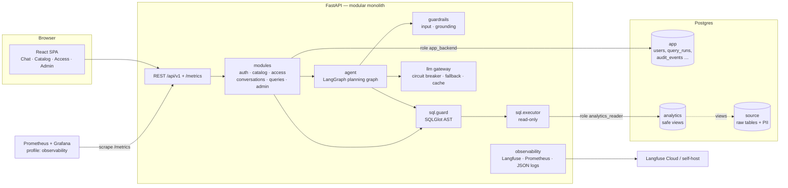
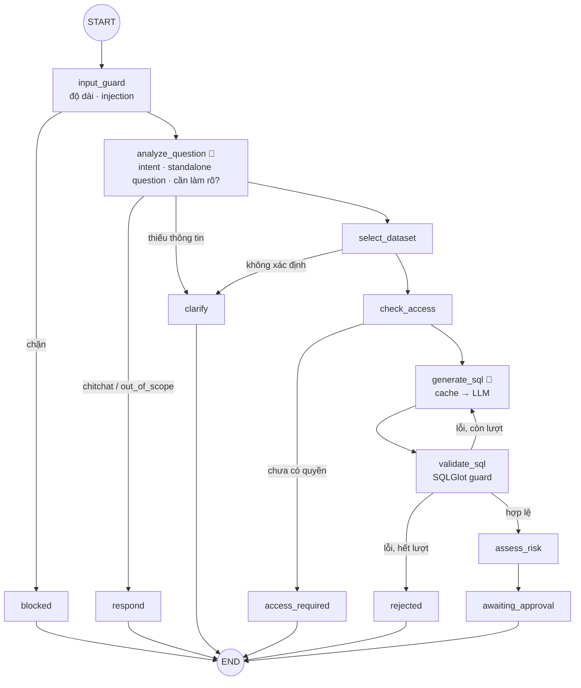

# Kiến trúc hệ thống — Text2SQL Agent

> Trợ lý phân tích **dữ liệu bán hàng bất động sản** bằng tiếng Việt: người dùng hỏi bằng ngôn ngữ
> tự nhiên, agent lập kế hoạch truy vấn, **người dùng duyệt (hoặc sửa) SQL**, hệ thống thực thi
> read-only trên vùng dữ liệu an toàn rồi trả bảng, biểu đồ và diễn giải có kiểm chứng.

## 1. Nguyên tắc thiết kế

| # | Nguyên tắc | Hệ quả |
|---|---|---|
| P1 | **LLM đề xuất, code quyết định** (Plan-Then-Execute) | LLM chỉ: hiểu câu hỏi, viết SQL nháp, viết diễn giải. Chọn dataset hợp lệ, kiểm tra quyền, kiểm tra SQL, thực thi là code tất định. |
| P2 | **Phòng thủ nhiều lớp** | Input rails → LLM rails → Output rails (SQL guard + grounding check) → role DB chỉ đọc → transaction `READ ONLY` + `statement_timeout` + `LIMIT`. |
| P3 | **Context minimization** | Prompt sinh SQL chỉ chứa metadata của **đúng một** dataset người dùng đã có quyền. |
| P4 | **Human-in-the-loop theo rủi ro** | Mặc định mọi SQL phải được duyệt; có chế độ `risk_based` cho phép tự chạy truy vấn rủi ro thấp. Người dùng có thể sửa SQL (Edit pattern). Yêu cầu chờ duyệt có TTL. |
| P5 | **Một nguồn sự thật** | `app.query_runs` giữ trạng thái nghiệp vụ; `app.audit_events` append-only giữ lịch sử quyết định. Graph không giữ state dài hạn. |
| P6 | **Semantic layer là code** | Dataset/metric/dimension/ví dụ khai báo bằng YAML trong git, validate khi khởi động và trong CI. |
| P7 | **Đo được** | Trace Langfuse, metrics Prometheus, chi phí theo token, eval có golden set + red-team, so sánh phiên bản theo cặp. |
| P8 | **Degrade gracefully** | Circuit breaker + fallback ladder; Langfuse/cache lỗi không làm hỏng request. |
| P9 | **Chạy được bằng một lệnh** | `docker compose up` (DB, migrate, seed, backend, frontend); `LLM_PROVIDER=demo` chạy không cần API key. |

## 2. Tổng quan



| Schema | Nội dung | Truy cập |
|---|---|---|
| `source` | Dữ liệu vận hành gốc, có PII (tên/SĐT/email khách) | Chỉ owner/migration |
| `analytics` | View đã bỏ PII, tên cột rõ nghĩa — **vùng duy nhất** agent được SELECT | Role `analytics_reader` (chỉ `SELECT`) |
| `app` | Trạng thái sản phẩm + audit | Role `app_backend` (không có quyền trên `source`) |

## 3. Luồng chính

```mermaid
sequenceDiagram
    actor U as User
    participant API
    participant G as Planning graph
    participant DB as app.query_runs / audit_events
    participant X as Executor (read-only)
    U->>API: POST /conversations/{id}/messages
    API->>G: question + history (N lượt) + entitlements
    G-->>API: outcome, sql, interpretation, risk_level, usage
    API->>DB: INSERT query_run + audit(query.planned)
    alt awaiting_approval
        API-->>U: SQL + diễn giải + mức rủi ro + hạn duyệt
        opt Edit
            U->>API: POST /queries/{id}/edit {sql}  (guard lại, hash mới)
        end
        U->>API: POST /queries/{id}/approve {sql_hash}
        API->>DB: UPDATE … SET status='running' WHERE status='awaiting_approval' AND sql_hash=? AND chưa hết hạn
    else risk_based & low risk
        API->>API: auto-execute (audit: auto_executed)
    end
    API->>API: re-check quyền + re-validate SQL
    API->>X: READ ONLY + statement_timeout + LIMIT
    API->>API: chart spec (tất định) + explanation (LLM) → grounding check
    API->>DB: succeeded + result + metrics + audit(query.executed)
    API-->>U: bảng + biểu đồ + diễn giải
```



### 3.1 Planning graph



🤖 = node gọi LLM. Mọi node khác tất định.

- **State phẳng, có kiểu, gọn** (`app/agent/state.py`, có `STATE_VERSION`): chỉ id, chuỗi, danh sách
  ngắn; không chứa kết quả truy vấn.
- **Làm rõ không cần checkpoint**: câu trả lời làm rõ là message kế tiếp; `analyze_question` nhận
  lịch sử gần nhất và viết lại thành *standalone question*.
- **Vòng sửa SQL**: lỗi guard được đưa lại cho LLM, tối đa `SQL_MAX_ATTEMPTS` lần.

### 3.2 Vòng đời query run

```text
                 ┌── edit (guard lại) ──┐
                 ▼                      │
blocked │ answered │ clarification │ access_required │ rejected        (kết thúc ở bước lập kế hoạch)
awaiting_approval ──approve──▶ running ──▶ succeeded | failed
        ├──cancel──▶ cancelled
        ├──hết TTL──▶ expired
        └──câu hỏi mới trong hội thoại──▶ superseded
```

`awaiting_approval → running` là một câu `UPDATE … WHERE status='awaiting_approval' AND sql_hash=:h
AND expires_at > now() RETURNING` — chống chạy hai lần và chống “duyệt SQL này, chạy SQL khác”.

## 4. Guardrails (defense in depth)

| Tầng | Cơ chế | Vị trí |
|---|---|---|
| Input rails | Giới hạn độ dài; phát hiện prompt injection (mẫu Việt + Anh); rate limit theo user | `app/guardrails/input.py`, node `input_guard`, `app/core/ratelimit.py` |
| LLM rails | Instruction hierarchy trong system prompt; **spotlighting**: câu hỏi người dùng nằm trong `<user_question>` và được khai báo là dữ liệu | `app/llm/prompts.py` |
| Output rails — SQL | Một câu `SELECT`; chặn DDL/DML; allowlist bảng của **đúng dataset**; `qualify` xác thực mọi cột; chặn hàm ngoài allowlist; ép `LIMIT` | `app/sql/guard.py` |
| Output rails — diễn giải | **Grounding check**: mọi con số trong diễn giải phải xuất hiện trong kết quả/câu hỏi (có quy đổi tỷ/triệu); trượt → dùng diễn giải tất định | `app/guardrails/grounding.py` |
| Human review | Duyệt/sửa SQL; TTL | `modules/queries` |
| Hạ tầng | Role `analytics_reader` chỉ `SELECT` trên `analytics`; `READ ONLY`; `statement_timeout` | migration + `app/sql/executor.py` |

## 5. Phân quyền

- **Application role** `user` | `admin`. Admin duyệt quyền, thu hồi quyền, xem thống kê — **không**
  mặc nhiên được đọc dữ liệu (tách biệt nhiệm vụ) và không tự duyệt yêu cầu của chính mình.
- **Data entitlement** theo dataset: `open` cho mọi user; `restricted` cần grant còn hiệu lực.
- Kiểm tra quyền **hai lần**: khi lập kế hoạch và ngay trước khi thực thi.

## 6. LLM gateway & độ tin cậy

```text
analyze / generate / explain
        │
        ▼
 ┌─────────────┐   miss   ┌───────────────────────────────┐
 │ plan cache  │────────▶ │ CircuitBreaker(primary model) │──fail/open──▶ fallback model ──fail──▶ demo provider (tất định)
 └─────────────┘          └───────────────────────────────┘
```

- Interface theo **tác vụ** (`analyze_question`, `generate_sql`, `explain_result`), output có schema Pydantic.
- **Circuit breaker** CLOSED → OPEN (sau N lỗi liên tiếp) → HALF_OPEN (sau thời gian chờ) → CLOSED.
- **Fallback ladder**: model chính → model dự phòng (tùy chọn) → `DemoProvider` (semantic compiler tất định).
  Diễn giải còn có bậc cuối là diễn giải tất định.
- **Plan cache** (TTL, ở `app/agent/cache.py`, chỉ lưu SQL đã qua guard): khóa = câu hỏi độc lập đã chuẩn hóa + dataset + `PROMPT_VERSION` + phiên bản
  semantic layer. Dùng khớp chính xác thay vì semantic similarity — xem ADR-11.
- **Chi phí**: bảng giá theo model → `cost_usd` trên mỗi query run.

## 7. Quan sát

- **Trace** (Langfuse, tùy chọn): một query run = một trace; graph + các lần gọi LLM + thực thi +
  diễn giải; feedback 👍/👎 đẩy về làm score.
- **Metrics** (Prometheus `/metrics`): latency HTTP/LLM/thực thi (histogram), outcome kế hoạch,
  token, chi phí, cache hit, trạng thái circuit, số lần guard chặn.
- **Dashboard + alert** (Grafana, profile `observability`): P50/P95/P99, error rate, cost/ngày,
  cache hit rate; alert P95 > 10 s, error rate > 5 %, circuit OPEN, guard chặn tăng đột biến.
- **SLO**: 99 % request lập kế hoạch thành công (không lỗi 5xx) trong 28 ngày; P95 lập kế hoạch < 8 s.
- **Log JSON** có `request_id`, PII trong câu hỏi được che trước khi ghi log.
- **Audit** append-only (`app.audit_events`, trigger chặn UPDATE/DELETE) + thống kê quyết định
  (approval rate, edit/override rate, thời gian chờ duyệt).

## 8. Đánh giá (eval)

| Bộ | Đo gì | Chạy ở đâu |
|---|---|---|
| `golden.jsonl` | Execution accuracy (so **tập kết quả**, không so chuỗi SQL), outcome accuracy, theo **slice** + khoảng tin cậy Wilson | Local/CI (demo) · thủ công (openai) |
| `redteam.jsonl` | SQL độc hại + prompt injection phải bị chặn 100 % | CI |
| Judge | Faithfulness của diễn giải, PASS/FAIL nhị phân; hiệu chuẩn TPR/TNR trên tập nhãn người | Thủ công |
| Compare | So sánh **theo cặp** hai báo cáo (cùng golden set): thay đổi theo case + McNemar | Trước khi đổi prompt/model |
| Chaos | Provider chính lỗi 100 % → circuit OPEN, fallback vẫn trả lời | `make chaos` |

Báo cáo gồm: accuracy theo slice, latency P50/P95/P99, token & chi phí/câu, cache hit, fallback rate.

## 9. Cấu trúc thư mục

```text
text2sql-agent/
├── backend/
│   ├── app/
│   │   ├── main.py            # app factory, middleware, routers, /metrics
│   │   ├── core/              # config, security, errors, logging (redaction), ratelimit, text
│   │   ├── db/                # engines (2 roles), ORM models
│   │   ├── semantic/          # Pydantic schema + registry cho YAML
│   │   ├── llm/               # contracts, prompts, openai, demo/, gateway (breaker, fallback, cost)
│   │   ├── agent/             # LangGraph: state, graph, plan cache
│   │   ├── guardrails/        # input rails, grounding check
│   │   ├── sql/               # guard (SQLGlot), executor (read-only)
│   │   ├── analysis/          # chart recommendation
│   │   ├── observability/     # Langfuse tracer, Prometheus metrics, audit writer
│   │   └── modules/           # auth · catalog · access · conversations · queries · admin
│   ├── semantic/              # sales · inventory · customers · staff_performance (YAML)
│   ├── migrations/            # Alembic baseline
│   ├── scripts/seed.py        # dữ liệu giả lập tất định + tài khoản demo
│   ├── eval/                  # datasets/, run.py, compare.py, judge.py, reports/  → docs/EVALUATION.md
│   └── tests/                 # unit/ (không cần DB) · integration/ (PostgreSQL)
├── frontend/src/              # api/ · features/{auth,chat,catalog,access,admin}/ · components/ · lib/
├── ops/                       # prometheus.yml, alert rules, grafana dashboard
├── docs/                      # ARCHITECTURE · DECISIONS · EVALUATION · RUNBOOK
├── docker-compose.yml  Makefile  .env.example  .github/workflows/
```

Quy tắc phụ thuộc: `modules → agent | sql | llm | guardrails | analysis → semantic | core | db`.
`agent` không biết HTTP/DB; `sql` không biết LLM; `llm` không biết DB.

Lý do của từng quyết định: [DECISIONS.md](DECISIONS.md).
